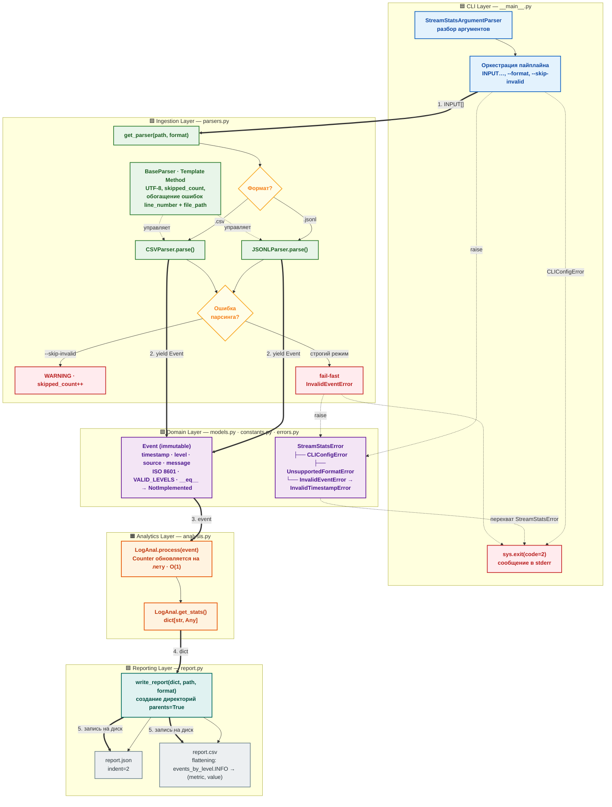

# streamstats

Высокопроизводительная CLI-утилита для потокового анализа структурированных логов (JSONL, CSV) с расчетом метрик в режиме одного прохода и минимальным потреблением памяти.

Вместо описания стандартных требований из ТЗ ниже разобраны нетривиальные инженерные решения, эволюция архитектуры и грабли, которые были сознательно обойдены в процессе реализации.

---

## Ключевые архитектурные решения

### 1. Эволюция модуля парсеров: почему шаблонный метод (Template Method)?

В первых набросках парсинг строился на изолированных процедурных функциях `parse_jsonl()` и `parse_csv()`. Однако такой подход быстро показал свои минусы:

* Дублирование логики: в каждой функции приходилось копировать обработку флага `--skip-invalid`, инкремент счётчиков и форматирование логов.
* Раздувание контекста: обогащение ошибок строкой и путём к файлу приходилось переписывать заново под каждый формат.

В итоге модуль был перепроектирован на паттерн **Template Method (`BaseParser`)**:

* **Базовый класс `BaseParser**` берёт на себя всю оркестрацию: открытие дескриптора в UTF-8, безопасную итерацию, перехват исключений модели, обогащение их контекстом (`line_number`, `file_path`), управление счётчиком `skipped_count` и логирование `WARNING` в режиме `--skip-invalid`.
* **Наследники (`JSONLParser`, `CSVParser`)** реализуют ровно два изолированных низкоуровневых шага:
1. `_iter_raw_items(file)` — как физически достать сырую порцию данных (строку или кортеж).
2. `_parse_item(item)` — как десериализовать сырой фрагмент в `dict[str, Any]`.


Благодаря этому добавление любого нового формата (например, TSV, Syslog или бинарного протокола) занимает 15 строк кода без изменения пайплайна валидации.

### 2. Подводные камни CSV: разделители, пустые строки и нумерация

Обработка CSV часто ломается на граничных случаях:

* **Динамический разделитель (`,` vs `;`) и пустые строки в заголовке:** метод `_preparer` предварительно просматривает файл, определяет разделитель и считает смещение, если файл начинается с пустых строк.
* **Ловушка «пустая строка vs пустая запись»:** если в CSV встречается строка `,,,`, стандартный `DictReader` отдаёт словарь с пустыми строками `""`. Простая проверка `if not any(row.values())` ошибочно посчитала бы такую строку пустой и пропустила её. В парсере разделены физически пустые строки файла (`all(v is None for v in row.values())`, которые просто игнорируются) и строки с пустыми значениями полей (которые являются невалидными записями и корректно триггерят `InvalidEventError` либо уходят в `skipped_count`).
* **Точная адресация ошибок:** номер строки высчитывается как `reader.line_num + counter_of_empty_lines`, что даёт 100% совпадение с реальной физической строкой в файле даже при наличии пустых строк в заголовке.
* **Лишние колонки:** проверка `if None in item` мгновенно отлавливает строки, где разделителей оказалось больше, чем заголовков.

### 3. Чистота доменной модели `Event`

Класс `Event` спроектирован полностью изолированным от инфраструктурного слоя:

* Он ничего не знает о файлах, строках или формате источника. Его задача — строгая защита доменных инвариантов: соответствие стандарту ISO 8601, допустимый список уровней логирования (`VALID_LEVELS`), непустой источник и строковые типы данных.
* В методе `__eq__` при сравнении с объектом чужого типа возвращается `NotImplemented` вместо `False` — идиоматичный подход в Python, позволяющий вызывающей стороне передать право сравнения обратному оператору.
* Обогащение исключений контекстом места сбоя происходит исключительно на уровне парсера через цепочку `raise ... from error`.

### 4. Генерация отчётов и плоский CSV (Bonus challenge)

Модуль `report.py` поддерживает сохранение агрегированных метрик как в JSON, так и в CSV без дублирования вычислений:

* Перед записью родительские директории создаются автоматически (`path.parent.mkdir(parents=True, exist_ok=True)`), что исключает падения, если путь вывода указывает во вложенную несуществующую папку.
* Для формата CSV реализовано автоматическое уплощение (flattening) вложенных структур через точечную нотацию (`events_by_level.INFO`, `top_error_sources.auth_service`), благодаря чему древовидная статистика ложится в плоский двухколоночный формат `(metric, value)`.

### 5. Архитектура CLI и синхронизация кодов выхода

В стандартном модуле `argparse` ошибки синтаксиса аргументов сразу вызывают `sys.exit(2)` с неконтролируемым выводом.

* В проекте создан `StreamStatsArgumentParser`, переопределяющий метод `.error()`, который выбрасывает кастомное исключение `CLIConfigError`.
* Весь пайплайн выполнения в `__main__.py` обёрнут в единый блок перехвата базового класса `StreamStatsError`.
* Это гарантирует, что любая ошибка — от некорректных флагов консоли и отсутствующих файлов до битых данных внутри логов — централизованно выводится в `sys.stderr`, возвращая единый код завершения `2` согласно спецификации.

---

## Запуск и использование

### Анализ логов

```bash
# Базовый запуск с автоматическим определением формата по расширению
poetry run python -m streamstats analyze logs/app.jsonl logs/server.csv --output reports/summary.json

# Запуск с принудительным форматом и пропуском некорректных записей
poetry run python -m streamstats analyze input_data --format jsonl --skip-invalid --output reports/summary.json

# Формирование отчёта в формате CSV
poetry run python -m streamstats analyze logs/app.csv --output reports/summary.csv

```

---

## Качество кода и тестирование

Проект протестирован с помощью `pytest` (36 тестов, покрывающих граничные случаи, Unicode, разные типы разделителей, пустые файлы, режимы fail-fast / skip-invalid и интеграцию с CLI).

Запуск проверок качества:

```bash
# Тесты
poetry run pytest -v

# Статический анализ и линтинг
poetry run ruff check .

# Проверка форматирования
poetry run black --check .

# Строгая статическая типизация
poetry run mypy src tests

```
## Архитектура системы


